# killer-skills

Claude Code skills for sites, repo pages and review councils

<picture>
  <source media="(prefers-color-scheme: dark)" srcset="docs/assets/cover-dark.svg">
  
</picture>

```powershell
irm https://raw.githubusercontent.com/Real-Fruit-Snacks/killer-skills/main/install.ps1 | iex
```

```sh
curl -fsSL https://raw.githubusercontent.com/Real-Fruit-Snacks/killer-skills/main/install.sh | sh
```

The skills I reach for when I want a job done properly rather than quickly. Each one does the whole job, then checks its own work before handing it back: killer-design screenshots the site it built, killer-repo renders the README the way GitHub will, and killer-council has fresh agents score the work against a bar they never see. They run in Claude Code and need Node.js and Python; on Windows the installer brings both when they're missing.

## What's in it

| Skill | Does | Download |
|---|---|---|
| `killer-design` | Designs and builds a website in hand-written HTML and CSS, then screenshots it at phone, tablet and desktop sizes and fixes what it sees | [zip](https://github.com/Real-Fruit-Snacks/killer-skills/releases/latest/download/killer-design.zip) |
| `killer-repo` | Rebuilds a repo page around one true wow moment: README, description, topics, social card and community files, rendered as GitHub shows them | [zip](https://github.com/Real-Fruit-Snacks/killer-skills/releases/latest/download/killer-repo.zip) |
| `killer-council` | Sends blind reviewer agents to score work from 1 to 100, fixes what they find and reconvenes until it passes your threshold | [zip](https://github.com/Real-Fruit-Snacks/killer-skills/releases/latest/download/killer-council.zip) |

In Claude Code, type a skill's name as a command (`/killer-repo`) or ask in plain words ("make this README better"). killer-council and killer-repo open with a few setup questions, so there are no options to remember. killer-design reads the project first and asks only what it can't work out.

Each skill is its own download. Name one to install just that skill:

```powershell
& ([scriptblock]::Create((irm https://raw.githubusercontent.com/Real-Fruit-Snacks/killer-skills/main/install.ps1))) killer-repo
```

```sh
curl -fsSL https://raw.githubusercontent.com/Real-Fruit-Snacks/killer-skills/main/install.sh | sh -s -- killer-repo
```

Or unzip a download into `~/.claude/skills` yourself; [killer-skills.zip](https://github.com/Real-Fruit-Snacks/killer-skills/releases/latest/download/killer-skills.zip) has all three. The installers check every archive against the release's `SHA256SUMS.txt` before they replace anything, and replace an installed skill whole, so files an older version had don't linger.

| Skill | Asks you | Needs |
|---|---|---|
| `killer-design` | Only what it can't find in the project | Node.js 20 or later, and Playwright with Chromium: the runtime below on Windows, otherwise installed into `~/.cache/killer-design` on first use. Web fonts come from the font pack |
| `killer-repo` | Scope, look, how to land the changes, and whether to convene a council | Node.js 20 or later, Playwright as for killer-design, and the GitHub CLI (`gh`) for the exact render and the repo checks |
| `killer-council` | Threshold, members, models, whether you take a seat, rounds and extras | Python 3.10 or later |

### The packs

Beside the skills, the installers put the packs those skills use into `~/.cache`, each in its own folder, checked against `SHA256SUMS.txt`, and only when it's missing or out of date:

| Pack | For | Size | What's in it |
|---|---|---|---|
| [Fonts](https://github.com/Real-Fruit-Snacks/killer-skills/releases/latest/download/killer-skills-fonts.zip) | killer-design, killer-repo | 14 MB | 74 faces, every one killer-design's typography guide names plus JetBrains Mono, as latin and latin-ext `.woff2` files with their licences, from Fontsource. killer-design's `fonts.mjs` copies them into a site |
| [Runtime](https://github.com/Real-Fruit-Snacks/killer-skills/releases/latest/download/killer-skills-runtime-windows-x64.zip), Windows | killer-design, killer-repo | 128 MB | Playwright 1.64.1, the Chrome 156 headless shell it launches and Mermaid 11.17.2. Skipped when killer-design already has Playwright and its Chromium |
| [Node.js](https://github.com/Real-Fruit-Snacks/killer-skills/releases/latest/download/killer-skills-node-windows-x64.zip), Windows | killer-design, killer-repo | 35 MB | Node.js 24.22.2, only when there's no Node.js 20 or later on the PATH |
| [Python](https://github.com/Real-Fruit-Snacks/killer-skills/releases/latest/download/killer-skills-python-windows-x64.zip), Windows | killer-council | 12 MB | Python 3.14.10's embeddable package, only when there's no Python 3.10 or later |

With them, the skills download nothing. CI checks that with the network cut off: it runs every Chromium script from the runtime on the packed Node.js, screenshots a page set in the pack's fonts, and runs killer-council's tests on the packed Python. A pack is the same bytes from one release to the next until its pins change, so updating the skills doesn't download it again. `install.sh` installs the font pack; the Windows packs come with `install.ps1`.

### Installing offline

Download the release's files into one folder: the two installers, `SHA256SUMS.txt`, the skills and whichever packs you want. The [release page](https://github.com/Real-Fruit-Snacks/killer-skills/releases/latest) lists them all. Then run an installer from that folder. It installs from the folder and downloads nothing; a pack that isn't there is skipped with a note.

```powershell
powershell -ExecutionPolicy Bypass -File .\install.ps1
```

```sh
sh install.sh
```

Name skills after either to install only those. `install.ps1` reads the `.zip` files and `install.sh` the `.tar.gz` files.

What still needs the network, packs or not: Claude Code itself, and parts of killer-repo. Its exact README render goes through GitHub's Markdown API; offline it makes an approximate render instead, labelled as one on every screenshot. Its link checks, its reads of the repo's settings through `gh`, and anything it publishes need GitHub too.

## Tested on

- Windows 11 · Claude Code 2.1.316 · Node.js 24.20.0 · Python 3.14.2: each skill run on a real project
- Ubuntu 24.04, Windows Server 2025 and macOS 26 in CI on every push: both installers (sh, Windows PowerShell 5.1, PowerShell 7), downloading and from a folder, the packager, fonts.mjs and the council script, with Python 3.12 and Node.js 24
- Windows Server 2025 in CI whenever the scripts or the pack pins change, and for every release: every pack, with shoot.mjs, icons.mjs, render.mjs, card.mjs, frames.mjs and fonts.mjs run on the packed Node.js and killer-council's tests on the packed Python, while npm, Playwright's downloads, `gh` and `fetch` can't reach the network
- *Not* tested: the skills themselves in Claude Code on macOS or Linux, or uploaded to claude.ai

## Known issues

- The runtime, Node.js and Python packs are built for Windows only. On macOS and Linux, the first screenshot killer-design or killer-repo takes runs `npm install --prefer-offline playwright` and downloads Chromium if it's missing, so that first run needs the network unless npm's cache already has Playwright.
- The font pack covers latin and latin-ext. A site in Cyrillic, Greek or Vietnamese needs its faces from Google Fonts.
- killer-repo's approximate render (offline, or with `render.mjs --offline`) uses the vendored marked with GitHub's main rules applied. Footnotes, math, emoji shortcodes and `#123` / `@user` links don't render the way GitHub draws them.
- killer-council's reviewers work in your folder, not a sandbox. Their brief tells them to change nothing, and `council.py verify` compares the work with a snapshot after every round, so a change gets caught, but nothing prevents it.
- A council that mixes providers (GPT, Gemini and others) needs T3 Code's delegation tools. Anywhere else, killer-council offers a mix of Claude models instead.
- GitHub has no API for a repo's social preview image, so killer-repo makes the card and tells you where to upload it.
- Animated SVGs made with killer-repo's `frames.mjs` keep moving in Chromium browsers for readers who turn motion off, because Chromium doesn't pass that setting into an SVG shown through ``.

## Configuration

The installers read these environment variables:

| Variable | Effect |
|---|---|
| `KILLER_SKILLS_VERSION` | A release tag to install, such as `v1.0.0`. Default: the latest release |
| `KILLER_SKILLS_DIR` | Where to install. Default `~/.claude/skills` |
| `KILLER_SKILLS_CACHE` | Where the packs go. Default `~/.cache`. The skills' scripts read it too |
| `KILLER_SKILLS_RUNTIME` | `skip`: the skills only, no packs. `all`: every pack the skills use, even when Node.js, Python or killer-design's Playwright is already there, as when setting up a machine that will be offline |

In PowerShell, set one with `$env:KILLER_SKILLS_VERSION = 'v1.0.0'` before the install line. In sh, put it before `sh`: `... | KILLER_SKILLS_VERSION=v1.0.0 sh`.

To run the tests and build the release files into `dist/`:

```sh
python3 -I tests/test_council.py
python3 -I tests/test_package.py
python3 -I tests/test_fonts.py
python3 -I tests/test_install.py
python3 tools/package.py
```

To build the packs (pinned in `tools/runtime.json` and `tools/fonts.json`) and test them all with the network cut off:

```powershell
.\tools\build-runtime.ps1 -Out dist
python -I tools/packs.py node --out dist
python -I tools/packs.py python --out dist
python -I tools/packs.py fonts --out dist
python -I tests/test_runtime.py dist/killer-skills-runtime-windows-x64.zip --node dist/killer-skills-node-windows-x64.zip --python dist/killer-skills-python-windows-x64.zip --fonts dist/killer-skills-fonts.zip
```

`python3 tools/packs.py pin` moves the pins to the newest Node.js 24, Python 3.14 and Fontsource releases; add a font family to `tools/fonts.json` first to pack it too.

To work on the skills offline you need the source (the release's "Source code" archive), Node.js 20 or later and Python 3.10 or later; on Windows the Node.js and Python packs are enough, with `~/.cache/killer-skills-node` on the PATH for the tests. The tests above then need no network, except `test_runtime.py`, which needs the packs. Building the packs, moving the pins and publishing need the network.

## License

MIT
